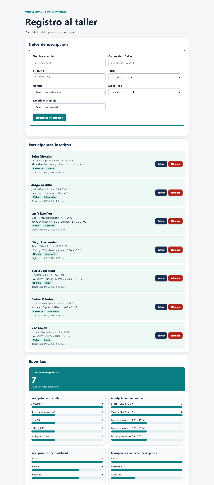
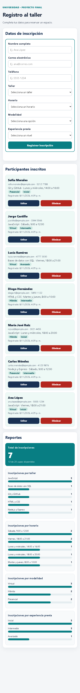

# Proyecto: Registro de participantes para un taller

## Objetivo
Aplicación web para que una universidad registre a los participantes de un taller de Desarrollo Web. El formulario pide nombre completo, correo, teléfono, taller, horario, **modalidad** y **experiencia previa**; envía los datos a una API hecha con Express y los guarda en una base de datos **SQLite**. Desde la misma página se pueden crear, consultar, editar y eliminar inscripciones, y un apartado de **Reportes** muestra conteos calculados con los datos guardados.

## Requisitos
- **Node.js 22.13 o superior** (se recomienda una versión LTS reciente). El proyecto usa el módulo integrado `node:sqlite`, así que no hace falta instalar un servidor de base de datos.
- Visual Studio Code.
- Conexión a internet la primera vez para instalar Express.

Comprueba tu versión en la terminal:

```bash
node -v
npm -v
```

## Ejecutar en VS Code
1. Abre esta carpeta con **File → Open Folder**.
2. Abre **Terminal → New Terminal**.
3. Ejecuta `npm install`.
4. Ejecuta `npm start`.
5. Abre `http://localhost:3000`.

### Si PowerShell bloquea npm.ps1
Si aparece un mensaje que dice que la ejecución de scripts está deshabilitada, usa estos comandos en la misma terminal:

```powershell
npm.cmd install
npm.cmd start
```

También puedes cambiar el perfil de la terminal de VS Code a **Command Prompt** y usar los comandos `npm install` y `npm start`.

## Base de datos
- La conexión está en `database.js`. Al iniciar el servidor se abre (o se crea) el archivo `registro_taller.db` junto a `server.js`.
- `CREATE TABLE IF NOT EXISTS` crea la tabla `inscripciones` la primera vez.
- Los datos **persisten**: siguen ahí al recargar la página y al detener (`Ctrl+C`) y volver a iniciar el servidor.
- El archivo `.db` **no se sube a GitHub** (está en `.gitignore`). Cada persona que clone el repositorio empieza con una base vacía.
- Para empezar de cero durante el desarrollo, detén el servidor y borra `registro_taller.db`.

### Tabla `inscripciones`
| Columna | Tipo | Uso |
|---|---|---|
| `id` | INTEGER PRIMARY KEY AUTOINCREMENT | Identificador único. |
| `nombre`, `correo`, `telefono` | TEXT NOT NULL | Datos del participante. |
| `taller`, `horario` | TEXT NOT NULL | Selecciones del formulario. |
| `modalidad` | TEXT NOT NULL | Campo nuevo: Presencial, Virtual o Híbrida. |
| `nivel_experiencia` | TEXT NOT NULL | Campo nuevo: Inicial, Intermedio o Avanzado. |
| `fecha_registro` | TEXT NOT NULL DEFAULT CURRENT_TIMESTAMP | Fecha y hora (UTC) en que se guardó. |

## API
| Método y ruta | Qué hace | Respuestas |
|---|---|---|
| `GET /api/inscripciones` | Lee todas las inscripciones de la base, de la más reciente a la más antigua. | `200` con un arreglo JSON. |
| `POST /api/inscripciones` | Valida y guarda una inscripción nueva. | `201` con `{ mensaje, id }`; `400` con `{ error }` si un dato no es válido o no hay cupo. |
| `PUT /api/inscripciones/:id` | Valida y actualiza la inscripción indicada. | `200` con `{ mensaje }`; `400` si el id o los datos no son válidos; `404` si no existe. |
| `DELETE /api/inscripciones/:id` | Elimina la inscripción indicada. | `200` con `{ mensaje }`; `400` si el id no es válido; `404` si no existe. |
| `GET /api/reportes/resumen` | Calcula los conteos de los reportes con `COUNT(*)` y `GROUP BY`. | `200` con `{ total, cupos, porTaller, porHorario, porModalidad, porNivel }`. |

Todas las consultas usan sentencias preparadas con `?`; el texto recibido nunca se pega dentro del SQL.

### Validaciones
| Regla | Navegador (HTML) | Servidor (Express) |
|---|---|---|
| Todos los campos son obligatorios | `required` | Rechaza valores vacíos o con solo espacios |
| Nombre de 2 a 80 caracteres | `minlength`, `maxlength` | Revisa la longitud |
| Correo con formato válido | `type="email"`, `maxlength="120"` | Expresión regular `texto@texto.texto` |
| Teléfono de 8 a 15 dígitos | `pattern` y `type="tel"` | Cuenta los dígitos y solo permite números, espacios, guiones y `+` |
| Taller, horario, modalidad y experiencia | `<select>` con opciones fijas | Comprueba que el valor esté en la lista de opciones permitidas |
| Cupo máximo de 20 personas | — | `POST` responde `400` si ya hay 20 inscripciones |

## Probar cada operación
Con el servidor encendido (`npm start`):

- **Crear (POST):** llena el formulario en `http://localhost:3000` y presiona **Registrar inscripción**. La persona aparece en la lista y los reportes cambian. Desde PowerShell:
  ```powershell
  $cuerpo = @{ nombre="Ana López"; correo="ana@ejemplo.com"; telefono="5555 1234"; taller="JavaScript"; horario="Viernes, 18:00 a 21:00"; modalidad="Virtual"; nivel_experiencia="Inicial" } | ConvertTo-Json
  Invoke-RestMethod -Method Post -Uri http://localhost:3000/api/inscripciones -ContentType "application/json; charset=utf-8" -Body ([Text.Encoding]::UTF8.GetBytes($cuerpo))
  ```
- **Leer (GET):** abre `http://localhost:3000/api/inscripciones` en el navegador.
- **Actualizar (PUT):** presiona **Editar** en una tarjeta de la lista. El formulario se llena con esos datos y el botón cambia a **Guardar cambios**. Cambia lo que necesites y guarda. **Cancelar edición** deja el formulario vacío otra vez.
- **Eliminar (DELETE):** presiona **Eliminar** en una tarjeta y confirma. Desde PowerShell:
  ```powershell
  Invoke-RestMethod -Method Delete -Uri http://localhost:3000/api/inscripciones/1
  ```
- **Validación:** intenta guardar con un correo como `ana-correo` o con un campo vacío. El navegador lo detiene, y si se envía directo a la API el servidor responde `400` con un mensaje.
- **Persistencia:** detén el servidor con `Ctrl+C`, vuelve a ejecutar `npm start` y recarga la página. Los registros siguen ahí.
- **Reportes:** abre `http://localhost:3000/api/reportes/resumen` y compara el total y cada grupo con la lista de la página.

## Capturas
Datos inventados. Ancho de escritorio (formulario, lista con acciones y reportes):



Ancho de teléfono (una sola columna):



## Estructura
```
server.js        Servidor Express y rutas de la API
database.js      Conexión a SQLite y creación de la tabla
public/
  index.html     Formulario, lista y reportes
  styles.css     Estilos y diseño adaptable
  app.js         fetch a la API, edición, eliminación y barras de reportes
bitacora.md      Bitácora del curso
```

## Entrega en GitHub
Sube el código fuente, `README.md` y `bitacora.md`. No subas `node_modules/`, archivos `.env` ni la base `registro_taller.db`; ya están excluidos en `.gitignore`.
