# Bitácora de repaso de Desarrollo Web

Completa una ficha por tema con tus palabras. No copies párrafos de los sitios consultados.

## HTML
- Resumen propio (2–3 frases):
- Dos términos clave y su explicación:
- Ejemplo de código explicado:
- Pregunta que podría aparecer en el examen:

## CSS
- Resumen propio (2–3 frases):
- Dos términos clave y su explicación:
- Ejemplo de código explicado:
- Pregunta que podría aparecer en el examen:

## JavaScript y DOM
- Resumen propio (2–3 frases):
- Dos términos clave y su explicación:
- Ejemplo de código explicado:
- Pregunta que podría aparecer en el examen:

## Node.js, Express y API
- Resumen propio (2–3 frases):
- Dos términos clave y su explicación:
- Ejemplo de ruta o solicitud explicado:
- Pregunta que podría aparecer en el examen:

## SQL
- Resumen propio (2–3 frases):
- Explica SELECT, INSERT, UPDATE y DELETE:
- ¿Qué son una clave primaria y una clave foránea?
- Pregunta que podría aparecer en el examen:

## Git y GitHub
- Resumen propio (2–3 frases):
- Explica add, commit y push:
- Diferencia entre Git y GitHub:
- Pregunta que podría aparecer en el examen:

## Actividad 1 · traza el recorrido (Ana presiona Registrar)

1. **¿Qué presenta los campos?** El HTML, con el formulario.
2. **¿Qué evita que el navegador recargue la página?** JavaScript, con `preventDefault()`.
3. **¿Qué componente recibe el JSON?** El servidor Express.
4. **¿Qué parte puede guardar el registro?** La base de datos. Hoy se guarda en memoria, en un arreglo.


**¿Por qué conviene validar un correo también en el servidor, aunque el formulario use type="email"?** Porque `type="email"` solo revisa en el navegador, y alguien puede saltarse esa revisión o enviar datos directo al servidor. Validar en Express asegura que solo se guarden correos válidos.

## Actividad 2


### Investiga y aplica

Fuente: MDN · Mi primer formulario HTML.

**1. Localiza main, section y form en `public/index.html`**

- **`main`** (línea 11): es la parte principal de la página. Ahí está todo el contenido importante.
- **`section`** (líneas 18 y 43): son dos apartados. El primero tiene el formulario de inscripción y el segundo muestra la lista de participantes.
- **`form`** (línea 20): es el formulario, donde la persona escribe sus datos y los envía con el botón "Registrar inscripción".

**2. Comprueba que cada `label for` coincide con el `id` de su control**

Sí, se comprueba. Los tres label for de index.html coinciden con el id de su campo: nombre, correo y taller.

**3. ¿Qué hacen name, type y required?**

- **`name`:** es el nombre que lleva cada dato cuando se envía. Así el servidor sabe qué es cada cosa, por ejemplo que "Ana" es el nombre y no el correo.
- **`type`:** dice qué clase de dato va en la casilla. `text` es para texto normal y `email` es para un correo; con `email` el navegador revisa que tenga forma de correo, como que lleve @.
- **`required`:** hace que la casilla sea obligatoria. Si se deja vacía, el navegador no deja enviar el formulario y avisa que hay que llenarla.

**Comprueba antes de continuar**


**Etiquetas semánticas (video "Aprende HTML y CSS – Curso Desde Cero")**

La respuesta no estaba en el tramo de 10:52 a 15:22. En ese tramo el instructor crea el archivo `index.html` en VS Code y explica `<!DOCTYPE html>`, que va en la primera línea y le dice al navegador qué versión de HTML se usa.

Las etiquetas semánticas aparecen en estos minutos:

- `<main>` (minuto 44:27): significa "principal". Encierra el contenido principal de la página, lo que no se repite en otras páginas. Solo debe haber uno por página.
- `<footer>` (minuto 2:03:22): significa "pie de página". Va al final de la página, después de `<main>`, y lleva información como datos de contacto o derechos de autor.

## Actividad 3

**Mi misión:** En `public/index.html` revisé los campos que ya estaban (nombre, correo y taller) y agregué dos nuevos:

- **Teléfono:** con su etiqueta y `type="tel"`.
- **Horario:** una lista para elegir entre Mañana, Tarde o Noche. Es obligatoria.

Ahora cada campo tiene su `id`, su `name` y su etiqueta, y todos son obligatorios. Si se deja uno vacío, el navegador no deja enviar el formulario.

**¿Qué información ya aparece en el HTML y qué falta para guardar el registro?**
En el HTML ya están los cinco datos que se piden: nombre, correo, teléfono, taller y horario. Lo que falta es que el JavaScript tome esos datos y los envíe al servidor, y que el servidor los revise y los guarde. El HTML solo muestra el formulario; por sí solo no guarda nada.

**¿Cuándo usarías `type="email"` y cuándo `type="tel"`?**

- **`type="email"`:** cuando pido un correo electrónico. El navegador revisa que tenga forma de correo, por ejemplo que lleve @, y en el celular muestra un teclado con @.
- **`type="tel"`:** cuando pido un número de teléfono. En el celular muestra el teclado de números. No revisa el formato, porque los teléfonos se escriben distinto en cada país.


**¿Qué atributo indica que un campo es obligatorio?** `required`. Hace que el navegador no deje enviar el formulario si el campo está vacío.

**Mejora aplicada al formulario (video, minutos 1:32:28 a 1:39:19)**

Agregué el atributo `placeholder` a los campos de nombre, correo y teléfono. Es un texto de ejemplo que aparece dentro de la casilla y se borra en cuanto la persona empieza a escribir. Por ejemplo, en el correo dice "Ej.: ana@correo.com".

¿Por qué? En el video el instructor explica que el `placeholder` sirve como pista para que el usuario sepa qué escribir en el campo. Así es más fácil llenar el formulario sin equivocarse.

El video también muestra `required`, pero mi formulario ya lo tenía en todos los campos.

## Actividad 4


### Práctica guiada

En `public/styles.css` el selector que da estilo al formulario es `form`. Le hice estos cambios:

1. **Borde:** le puse un borde verde azulado (`#087e83`), del mismo color que el botón.
2. **Padding:** le di `1.5rem`. Es el espacio de **adentro**: separa el borde de los campos, así los campos ya no quedan pegados a la orilla.
3. **Margin:** le di `1rem 0`. Es el espacio de **afuera**: separa el formulario del título de arriba y del mensaje de abajo.

**¿Qué espacio cambió?** Con el padding creció el espacio entre el borde y los campos. Con el margin creció el espacio entre el formulario y lo que tiene alrededor.

**Mi regla CSS propia**

```css
form {
  border: 2px solid #087e83;
  border-radius: 12px;
  padding: 1.5rem;
  margin: 1rem 0;
}
```

Esta regla selecciona el elemento `<form>`, que es el formulario de inscripción. Le pone un borde de color con esquinas redondeadas, espacio por dentro (padding) y espacio por fuera (margin).

**Selector, propiedad y valor en mi formulario (video, minutos 2:09:22 a 2:18:10)**

En el video el instructor explica que cada regla CSS tiene tres partes: el **selector** (a qué se le aplica el estilo), la **propiedad** (qué se quiere cambiar) y el **valor** (cómo se quiere que quede). Así se ven en la regla de mi formulario:

```css
form {
  border: 2px solid #087e83;
  padding: 1.5rem;
  margin: 1rem 0;
}
```

- **Selector:** `form`. Dice a qué se le aplica el estilo; en este caso, al formulario de inscripción.
- **Propiedades:** `border`, `padding` y `margin`. Son lo que quiero cambiar: el borde, el espacio de adentro y el espacio de afuera.
- **Valores:** `2px solid #087e83`, `1.5rem` y `1rem 0`. Dicen cómo quiero que quede cada cosa: un borde verde azulado de 2 píxeles, un espacio entre el borde y los campos, y un espacio arriba y abajo del formulario.

### Desafío · Flexbox Froggy

Completé los primeros 8 niveles del juego en español.

**Lo que escribí en cada nivel:**

**Nivel 1:** `justify-content: flex-end;`

Movió la rana hacia la derecha, hasta su hoja.


**Nivel 2:** `justify-content: center;`

Juntó las ranas en el centro del estanque.


**Nivel 3:** `justify-content: space-around;`

Repartió las ranas con el mismo espacio alrededor de cada una.


**Nivel 4:** `justify-content: space-between;`

Puso una rana en cada orilla y la otra en medio, con el mismo espacio entre ellas.


**Nivel 5:** `align-items: flex-end;`

Bajó las ranas hasta el fondo del estanque.


**Nivel 6:** `justify-content: center;` y `align-items: center;`

Puso la rana justo en el centro: al medio de lado a lado y de arriba abajo.


**Nivel 7:** `justify-content: space-around;` y `align-items: flex-end;`

Repartió las ranas con espacio entre ellas y las bajó al fondo.


**Nivel 8:** `flex-direction: row-reverse;`

Puso las ranas en orden al revés, de derecha a izquierda, para que coincidieran con sus hojas.


**Dos propiedades que usé:**

- **`justify-content`:** mueve los elementos de lado a lado (cuando están en fila). Con ella puedo mandarlos al final, al centro o repartirlos con espacio entre ellos. La usé en los niveles 1 a 4.
- **`align-items`:** mueve los elementos de arriba hacia abajo (cuando están en fila). Con ella puedo bajarlos o centrarlos. La usé en los niveles 5, 6 y 7.

**Media query de 640 px**

El archivo `styles.css` no tenía la regla, así que la agregué al final:

```css
@media (max-width: 640px) {
  .contenedor { padding: 1.5rem 0; }
  .panel { padding: 1rem; }
  form { padding: 1rem; }
}
```

Esto quiere decir que, cuando la pantalla mide 640 px o menos (como un teléfono), los espacios se hacen más pequeños para que el formulario tenga más lugar. Al reducir el ancho del navegador, los bordes del formulario y de los paneles quedan más cerca de los campos.

**Comprueba antes de continuar**


**¿Cuándo se aplica la regla de este ejemplo?** Cuando el ancho de la pantalla es de 640 px o menos. Ahí el media query cambia los estilos.

**Registro: una propiedad de Flexbox y una regla de media query**

- **Propiedad de Flexbox:** `justify-content: center;`
  **Cambio visual:** los elementos se juntan en el centro, de lado a lado. En Flexbox Froggy, las ranas se movieron al centro del estanque.

- **Regla de media query:**

  ```css
  @media (max-width: 640px) {
    form { padding: 1rem; }
  }
  ```

  **Cambio visual:** cuando la pantalla mide 640 px o menos, el espacio de adentro del formulario se hace más pequeño (de 1.5rem a 1rem). Así los campos quedan más cerca del borde y tienen más lugar en el teléfono.

### Pruebas de manipulación del formulario

El 8 de noviembre de 2026 hice 10 pruebas en `http://localhost:3000/` usando la consola del navegador (`F12`). La idea era ver qué pasa si alguien cambia el formulario a propósito: quitar validaciones, meter opciones falsas o escribir código en los campos.

**Estado inicial del formulario**

El formulario sin cambios: nombre, correo, taller (6 opciones), teléfono y horario. Todos tienen `required` y el correo es `type="email"`.


**Prueba 1: código en el campo Nombre**

```js
document.getElementById("nombre").value = '<script>alert("XSS")</script>';
```

Escribí una etiqueta `<script>` en el nombre desde la consola. El campo la acepta como si fuera texto normal.


**Prueba 2: quitar `required` y poner un correo falso**

```js
document.getElementById("correo").removeAttribute("required");
document.getElementById("correo").value = "esto-no-es-email";
document.getElementById("nombre").removeAttribute("required");
```

Se puede quitar `required` desde la consola. Aun así, el `type="email"` sigue bloqueando el envío normal del navegador.


**Prueba 3: agregar un taller que no existe**

```js
const select = document.getElementById("taller");
const fakeOption = document.createElement("option");
fakeOption.value = "Taller Hackeado";
fakeOption.textContent = "Taller Hackeado (inyectado)";
select.appendChild(fakeOption);
select.value = "Taller Hackeado";
```

Agregué una opción inventada a la lista de talleres y quedó seleccionada.


**Prueba 4: caracteres raros en Teléfono**

```js
const tel = document.getElementById("telefono");
tel.setAttribute("type", "text");
tel.removeAttribute("pattern");
tel.value = '">';
```

Cambié el teléfono a tipo texto y escribí una etiqueta ``. El campo lo acepta.


**Prueba 5: agregar un horario que no existe**

```js
const horario = document.getElementById("horario");
const fake = document.createElement("option");
fake.value = "Domingo, 3:00 AM a 5:00 AM";
fake.textContent = "Domingo - 3:00 a 5:00 AM (inyectado)";
horario.appendChild(fake);
horario.value = "Domingo, 3:00 AM a 5:00 AM";
```

Igual que con el taller, agregué un horario inventado (domingo de 3 a 5 AM) y quedó seleccionado.


**Prueba 6: se detecta el correo inválido**

```js
document.getElementById("formulario-registro").requestSubmit();
// Resultado: "El correo no tiene un formato válido."
```

Al enviar con el correo `esto-no-es-email` aparece el mensaje "El correo no tiene un formato válido." y no se guarda nada.


**Prueba 7: todos los campos cambiados**

```js
document.getElementById("nombre").value = '';
document.getElementById("correo").value = "atacante@malicioso.com";
document.getElementById("taller").value = "Taller Hackeado";
document.getElementById("telefono").value = "0000-0000 DROP TABLE users";
document.getElementById("horario").value = "Domingo, 3:00 AM a 5:00 AM";
```

Llené todos los campos con valores falsos: código en el nombre, un correo inventado pero bien escrito, el taller y el horario falsos, y un texto de SQL en el teléfono.


**Prueba 8: el envío con datos falsos se guarda**

```js
document.getElementById("formulario-registro").requestSubmit();
// Resultado: "Inscripción registrada: ."
```

El formulario se envió y se guardó. El mensaje de confirmación muestra el nombre con la etiqueta, pero como **texto**: no se ejecuta.


**Prueba 9: los datos falsos aparecen en la lista**

La lista de participantes muestra los dos registros con nombres raros, el taller falso y el horario falso. Las etiquetas se ven como texto y **no se ejecutan**, porque `app.js` usa `textContent` en lugar de `innerHTML`.


**Prueba 10: cambiar los textos de la página**

```js
document.querySelector("h1").textContent = "Registro HACKEADO";
document.querySelector(".etiqueta").textContent = "Sitio Comprometido - Prueba de seguridad";
document.querySelector("#titulo-formulario").textContent = "Datos alterados";
```

Cambié el título y otros textos. Ese cambio solo se ve en **mi** navegador y se borra al recargar la página; las demás personas siguen viendo la página normal.


**Lo que aprendí**

1. Todo lo del navegador (`required`, `type="email"`, las opciones de las listas) se puede cambiar desde la consola. Por eso el servidor tiene que revisar los datos otra vez.
2. Mi servidor **sí** revisa que no falten campos, que el correo esté bien escrito y que haya cupo. Por eso en la prueba 6 el correo falso fue rechazado.
3. Lo que el servidor **todavía no** revisa es que el taller y el horario sean de la lista real. Por eso se guardaron "Taller Hackeado" y el horario del domingo.
4. Las etiquetas como `<script>` no se ejecutan porque la página usa `textContent`, que las muestra como texto.
5. El texto "DROP TABLE" no hace daño en este proyecto porque todavía no hay base de datos; los registros se guardan en un arreglo. Cuando se use SQL, hay que usar consultas preparadas.

**Recomendaciones**

1. Revisar en el servidor que el taller y el horario estén en la lista permitida.
2. Seguir usando `textContent` para mostrar datos, nunca `innerHTML`.
3. Cuando se use una base de datos, usar consultas preparadas para evitar SQL Injection.

## Actividad 5

**Ejemplo: lógica de cupos**

```js
const cuposMaximos = 20;
let inscritos = 0;

function hayCupo() {
  return inscritos < cuposMaximos;
}

if (hayCupo()) {
  inscritos++;
}
```


**Mi modificación**

```js
const cuposMaximos = 20;
let inscritos = 20;

function hayCupo() {
  return inscritos < cuposMaximos;
}

if (hayCupo()) {
  inscritos++;
} else {
  console.log("Ya no hay cupo");
}
```

Cambié `inscritos` para que empiece en 20 y agregué un `else`. Ahora 20 no es menor que 20, así que no hay cupo: `inscritos` se queda en 20 y aparece el mensaje "Ya no hay cupo".

**Pausa y predice (video, minutos 8:03 a 17:46)**

Evidencia: video "Aprende JavaScript - Curso Completo desde Cero".


En ese tramo no aparece ninguna suma. Es la introducción a las variables: los tipos de datos, cómo crear una variable con `var`, cómo cambiarle el valor, cómo ponerles nombre (por ejemplo `miNombre`) y la diferencia entre `var`, `let` y `const`.

Lo más parecido a predecir fue este código. Pausé el video antes de ver el resultado:

var a;
var b;
console.log(a);
a = 56;
console.log(a);

**Mi predicción:** primero `undefined` y después `56`, porque `a` existe pero todavía no tiene valor, y luego se le da el 56. El video mostró exactamente eso.

**Reto de lectura**

Si cambio `inscritos` a 20:

- **¿Se ejecutará `inscritos++`?** No. 20 no es menor que 20, entonces no hay cupo y no se suma nada.
- **¿Qué devuelve `hayCupo()`?** Devuelve `false` (falso).

**Un caso para `const` y otro para `let`**

- **`const`:** para algo que no va a cambiar, como el número máximo de cupos del taller: `const cuposMaximos = 20;`
- **`let`:** para algo que sí va a cambiar, como la cantidad de inscritos, que sube cada vez que alguien se registra: `let inscritos = 0;`

### Aplicado al proyecto

**Clases `.tarjeta` y `.titulo` (CSS)**

Agregué estas dos reglas en `public/styles.css`:

```css
.tarjeta {
  padding: 1rem;
  border: 1px solid #dce3ed;
  border-radius: 12px;
}

.titulo {
  color: #183153;
}
```

- **`.titulo`:** se lo puse a los dos títulos `h2` ("Datos de inscripción" y "Participantes inscritos"). Les cambia el color a un azul oscuro.
- **`.tarjeta`:** se lo pone JavaScript a cada participante de la lista. Cada uno se ve como una cajita con borde fino, esquinas redondeadas y espacio por dentro.

**Lógica de cupos (JavaScript)**

En `server.js` usé la misma idea de la actividad:

```js
const cuposMaximos = 20;

function hayCupo() {
  return inscripciones.length < cuposMaximos;
}
```

Cuando alguien se registra, el servidor revisa si todavía hay cupo. Si ya hay 20 inscritos, no guarda el registro y responde "Ya no hay cupos disponibles para el taller". Aquí los inscritos se cuentan con la cantidad de registros guardados en la lista.

Para que esto funcionara, también completé el envío del formulario: ahora JavaScript evita que la página se recargue, manda los datos al servidor y muestra la lista de participantes.

## Actividad 6

**Tu turno · lo que hice en `public/app.js`**

1. **Busqué el formulario por su id:** `document.querySelector("#formulario-registro")`.
2. **Escuché el envío:** `formulario.addEventListener("submit", ...)`.
3. **Evité la recarga:** `evento.preventDefault()`.
4. **Leí los valores con FormData** y agregué `console.log(datos.nombre)` para ver el nombre en la consola.

**¿Para qué usamos `preventDefault()`?** Para que la página no se recargue al presionar el botón. Así los datos no se pierden y JavaScript puede enviarlos él mismo al servidor.


## Actividad 7

### Práctica en OneCompiler · Funciones y Arreglos

Resolví 12 ejercicios del curso de JavaScript de OneCompiler (sección 5, Funciones, y sección 6, Arreglos). Todos dieron la salida correcta.

**Ejercicio 1. Funciones 1 · Defining a Function**

Creé la función `greet(name)`, que muestra "Welcome, <nombre>!". Con la entrada Dave mostró "Welcome, Dave!".

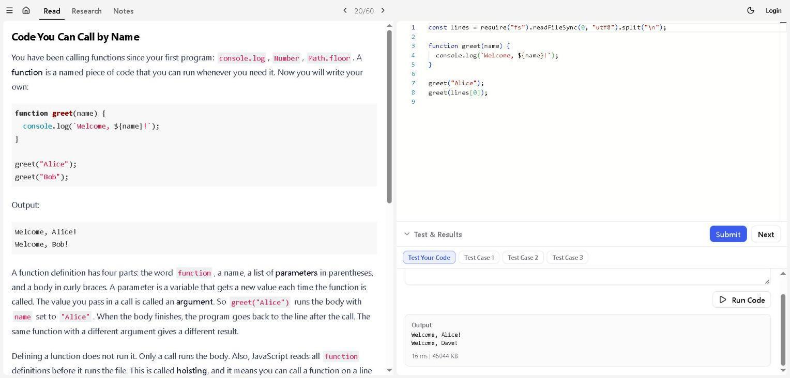

**Ejercicio 2. Funciones 2 · Returning a Value**

Hice `square(n)`, que devuelve un número multiplicado por sí mismo, y `average(a, b)`, que devuelve el promedio de dos números. Con 6 y 7 dio 36 y 6.5.

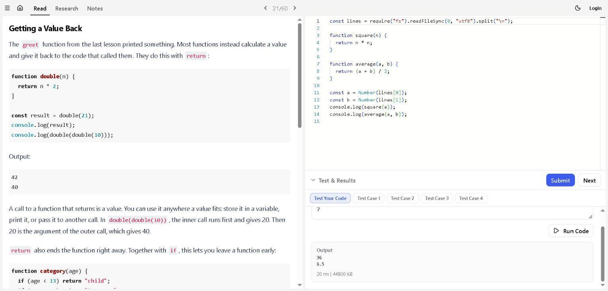

**Ejercicio 3. Funciones 3 · Arrow Functions**

Escribí `triple`, `add` y `shout` en la forma corta (funciones flecha). Con 5 y "hey" dio 15, 9 y "HEY!".

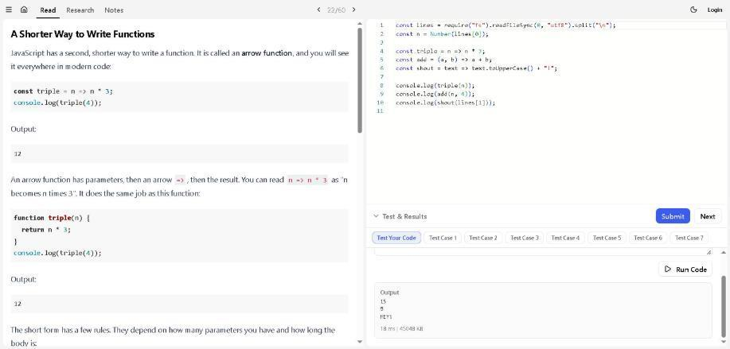

**Ejercicio 4. Funciones 4 · Default Parameters**

La función `greet` usa "Hello" si no le paso otro saludo. Con Ada mostró "Hello, Ada!" y "Welcome back, Ada!".

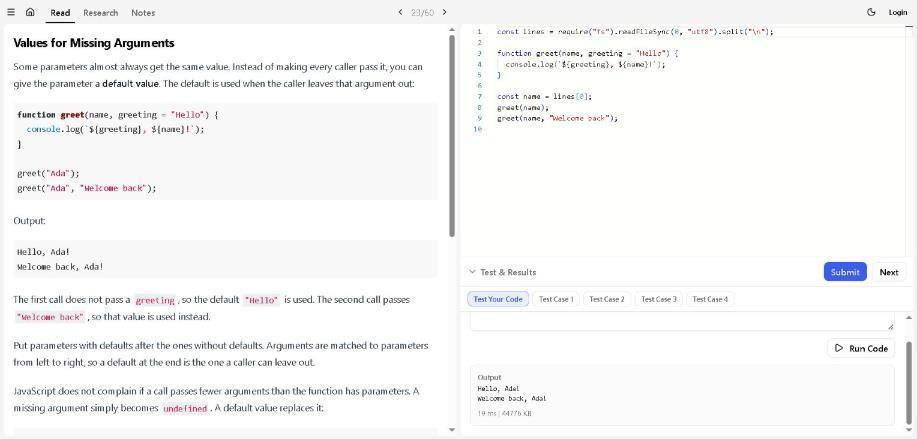

**Ejercicio 5. Funciones 5 · Functions as Values**

`applyTwice(fn, x)` recibe otra función y la usa dos veces. Con 5 dio 20 y con "wow" dio "wow!!".

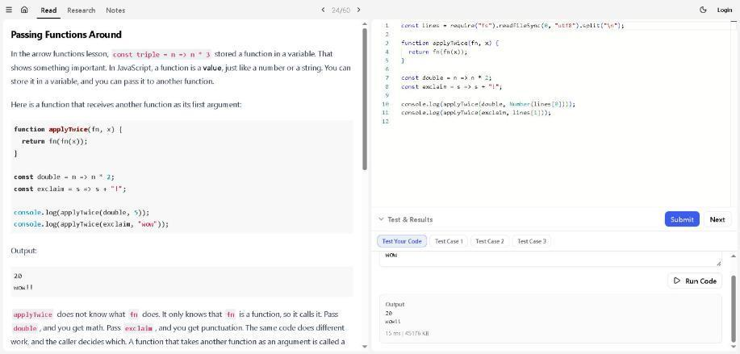

**Ejercicio 6. Funciones 6 · Scope and Closures**

`makeCounter()` crea un contador que recuerda su número. Cada vez que lo llamo sube: 1, 2, 3. Un contador nuevo empieza otra vez en 1.

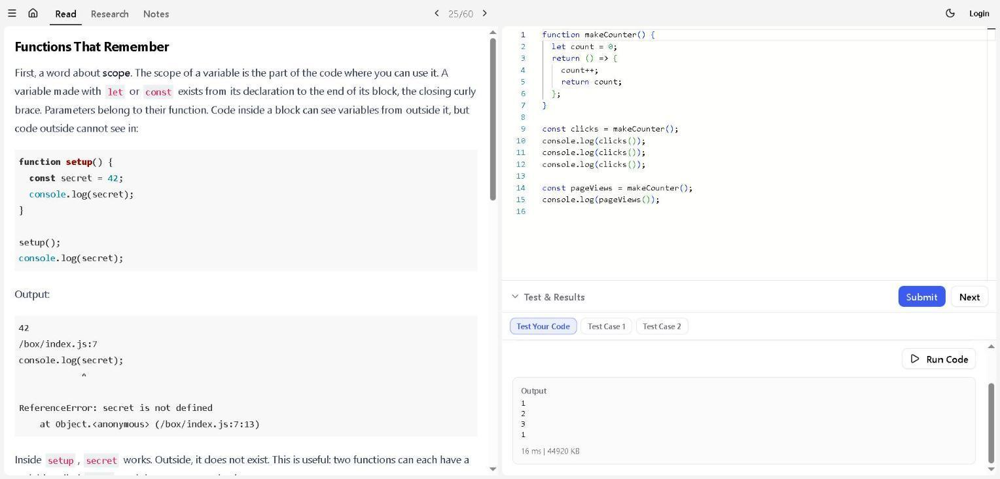

**Ejercicio 7. Arreglos 1 · Array Basics**

Con un arreglo de temperaturas usé `length` (cuántos hay), `temps[0]` (el primero), `temps.at(-1)` (el último) y `temps[i]` (el de una posición). Con la entrada 2 mostró 5, 18, 23 y 25.

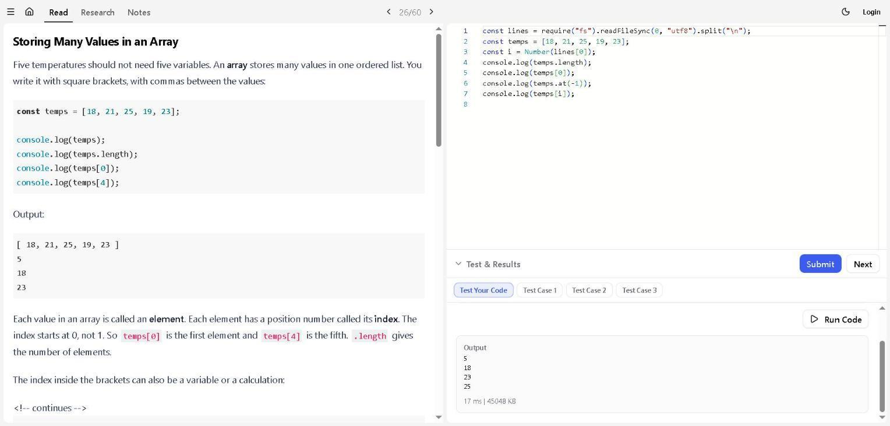

**Ejercicio 8. Arreglos 2 · push, pop, shift, unshift**

Agregué tres nombres con `push`, puse "VIP" al inicio con `unshift` y quité el último con `pop`. Quedó `['VIP', 'Alice', 'Bob']`.

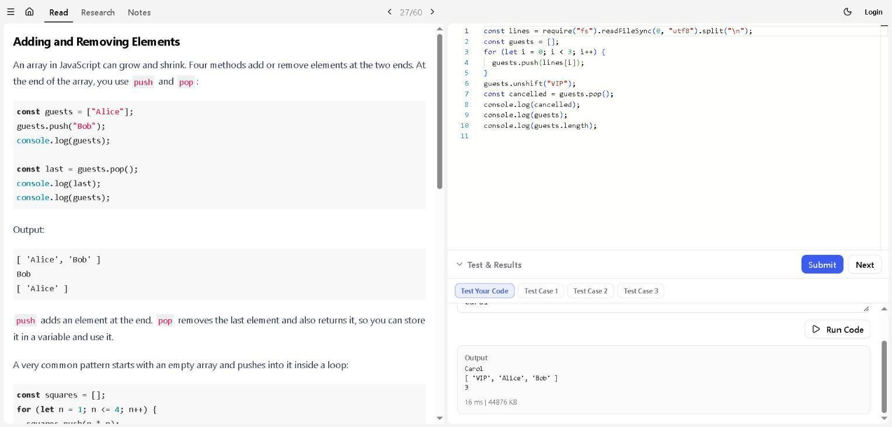

**Ejercicio 9. Arreglos 3 · slice y spread**

`slice` copia una parte del arreglo sin cambiar el original, y `[...nums, 60]` crea un arreglo nuevo con un 60 al final. Con 1 y 3 dio `[20, 30]`.

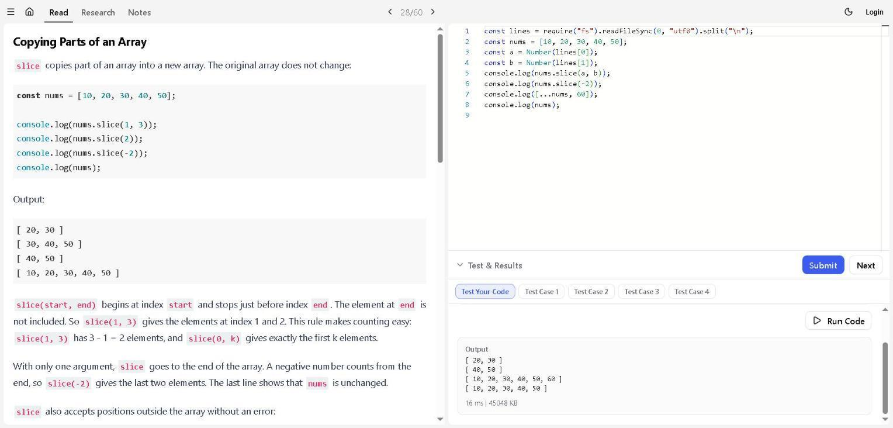

**Ejercicio 10. Arreglos 4 · forEach**

Con `forEach` recorrí un menú y mostré cada plato numerado con su precio. Al final sumé el total: 18.

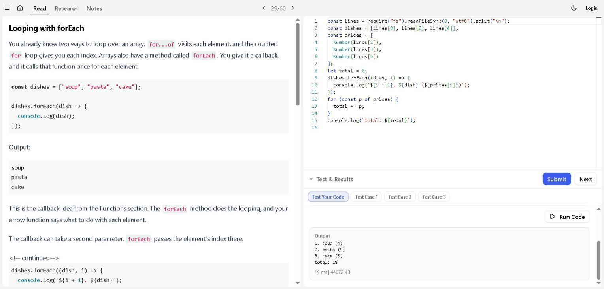

**Ejercicio 11. Arreglos 5 · Sorting**

Ordené los números 31 4 15 9 26 con `toSorted()`. Sin indicar cómo ordenar los toma como texto. Con `(a, b) => a - b` quedan de menor a mayor y con `(a, b) => b - a` de mayor a menor.

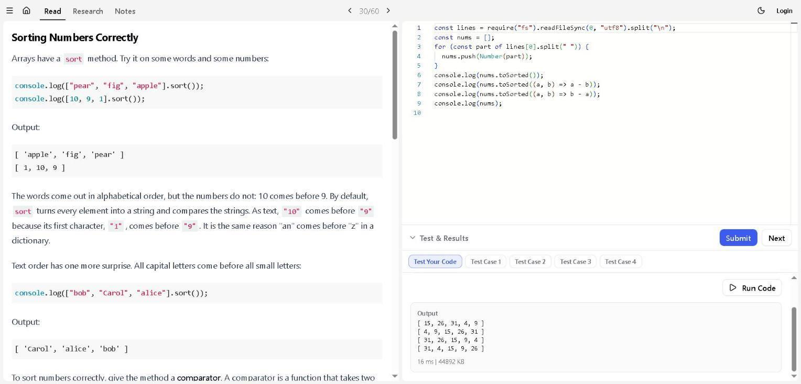

**Ejercicio 12. Arreglos 6 · Arrays and References**

`backup = [...sales]` hace una copia de verdad. Al cambiar `sales`, la copia `backup` no cambió.

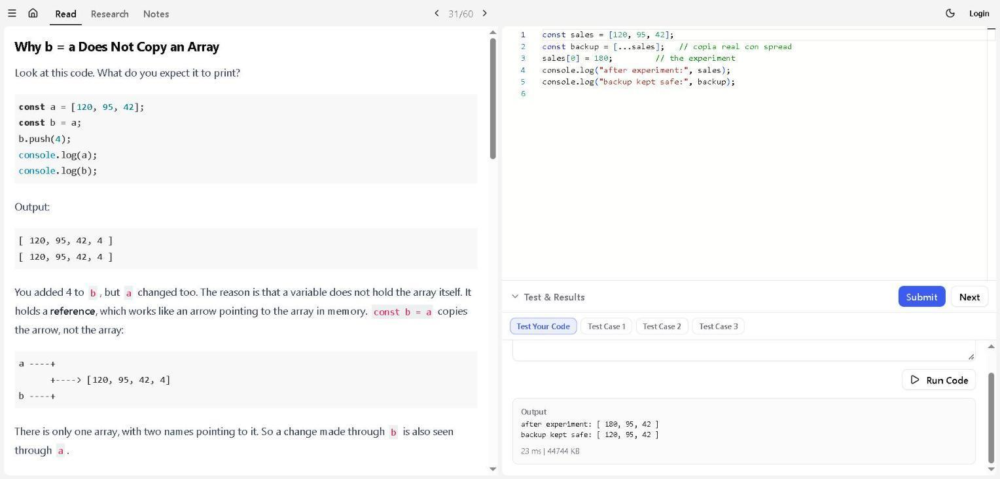

### Reto guiado · Cuenta las inscripciones

**Práctica en OneCompiler (funciones y arreglos)**

```js
const numeros = [4, 8, 15];

function sumar(lista) {
  let total = 0;
  for (const numero of lista) {
    total += numero;
  }
  return total;
}

console.log(sumar(numeros)); // 27
```

La función recorre el arreglo, va sumando cada número y al final devuelve el total: 27.

**Práctica en CodePen**

HTML:

```html
<p id="resultado"></p>
```

JS:

```js
const inscripciones = ["Ana", "Luis", "María"];

function contarInscripciones() {
  return inscripciones.length;
}

document.querySelector("#resultado").textContent =
  "Hay " + contarInscripciones() + " inscripciones.";
```

El arreglo `inscripciones` guarda tres nombres. La función usa `length` para contar cuántos hay y devuelve 3. Después ese número se muestra en el párrafo: "Hay 3 inscripciones."

### Video: arreglos y funciones

Evidencia: video "Aprende JavaScript - Curso Completo desde Cero".


**Arreglos (1:45:24 – 2:18:40)**

- **Qué son:** sirven para guardar varios valores en una sola variable, como una lista. Se escriben entre corchetes y separados por comas, por ejemplo `["Nora", 24]`. Pueden mezclar distintos tipos de datos.
- **Arreglos dentro de otros arreglos:** un arreglo puede tener otros arreglos adentro, como una lista de productos con nombre, precio y código. Para llegar a un dato de adentro se usan dos números: `miArreglo[1][2]`.
- **Índices:** las posiciones empiezan en 0. Para leer el primer valor se usa `miArreglo[0]`.
- **Cambiar valores:** se le da un valor nuevo a una posición, por ejemplo `miArreglo[0] = 40`.
- **Métodos principales** (el video usa un arreglo con las estaciones del año):
  - `push()`: agrega un elemento al final.
  - `pop()`: quita el último elemento.
  - `shift()`: quita el primero.
  - `unshift()`: agrega un elemento al principio.
- **Práctica final:** una lista de compras. Con los índices arma mensajes como "Voy a comprar 7 unidades de pollo".

**Funciones (desde 2:18:41)**

- **Qué son:** bloques de código con nombre que se pueden usar varias veces. En el video crea `mostrarMensaje()` y la llama varias veces para mostrar "Hola mundo" sin repetir el código.
- **Parámetros y argumentos:** crea la función `sumar(a, b)`. Los parámetros (`a` y `b`) son los espacios que recibe la función, y los argumentos son los valores que le mandas al usarla, en el mismo orden.
- **Ventaja:** el código queda más corto y sin repetir. Si hay que cambiar algo, se cambia en un solo lugar.
- **Alcance de las variables:**
  - **Global:** se crea fuera de las funciones y se puede usar en todo el programa.
  - **Local:** se crea dentro de una función y solo sirve ahí. Si la usas afuera, da error (`ReferenceError`).
  - **Si se llaman igual:** dentro de la función se usa la local, y afuera se sigue usando la global.

## Actividad 8

### Instalación y primer inicio

1. **Node.js LTS:** ya estaba instalado. npm viene incluido.
2. **Editor:** abrí Visual Studio Code.
3. **Carpeta correcta:** abrí `registro-taller-estudiante` y se ven `package.json` y `server.js`.
4. **Terminal:** en Terminal → New Terminal ejecuté:
   - `node -v` → `v26.13.0` (es mayor que 18, así que sirve).
   - `npm -v` → `11.20.0`.
5. **Dependencias:** ejecuté `npm install` y terminó con "found 0 vulnerabilities" (sin problemas).
6. **Iniciar el servidor:** ejecuté `npm start` y salió el mensaje "Servidor disponible en http://localhost:3000". Al abrir esa dirección carga la página "Registro al taller de Desarrollo Web".
7. **Detener el servidor:** con `Ctrl+C` en la terminal el servidor se apaga y la página ya no carga.

**¿Para qué sirve cada comando?**

- `node -v` y `npm -v`: muestran qué versión está instalada.
- `npm install`: descarga lo que el proyecto necesita para funcionar (en este caso, Express).
- `npm start`: enciende el servidor para poder usar la página.
- `Ctrl+C`: apaga el servidor.

**Comprueba antes de avanzar**


**Video: descargar e instalar Node.js**

Evidencia: video "Aprende Node.js y Express - Curso desde Cero", minuto 21:03, en la parte "Descargar e instalar Node.js".


**Resumen del tramo (minutos 21:01 a 24:34)**

En esta parte el instructor enseña a instalar Node.js. Entra a la página oficial nodejs.org, la pone en español y compara las dos versiones: la **LTS**, que es la recomendada para la mayoría porque recibe soporte por más tiempo, y la **Actual**, que trae lo más nuevo. Dice que para el curso sirve cualquiera. Después descarga el instalador para Windows y lo abre.

En el instalador da clic en Next, acepta la licencia y deja todo como viene. Insiste en que quede marcada la opción **Add to PATH**, porque sin ella no se puede usar el comando `node` en la terminal. Al final da clic en Install y luego en Finish.

**Yo ya tenía Node.js instalado** (versión `v26.13.0`), así que no tuve que instalarlo otra vez. Solo repetí el recorrido en la página oficial para ver los pasos. La página se ve distinta a la del video porque cambió de diseño, pero los pasos son los mismos.

**Figura 1.** Página principal de nodejs.org en español.


**Figura 2.** Página de descarga con la versión LTS elegida para Windows. Abajo muestra los comandos `node -v` y `npm -v` para revisar la versión.


**Figura 3.** Los sistemas para los que se puede descargar: Windows, macOS, Linux y AIX.


**Figura 4.** El botón **Windows Installer (.msi)**, que es el instalador que se usa en el video.


**Pasos del instalador en Windows**

1. Abrir el archivo `.msi` desde la carpeta Descargas.
2. Dar clic en Next en la pantalla de bienvenida.
3. Aceptar la licencia y dar Next.
4. Dejar la carpeta donde se instala como viene y dar Next.
5. Revisar que esté incluida la opción **Add to PATH** y dar Next.
6. Dejar sin marcar la casilla de herramientas extra y dar Next.
7. Dar clic en Install y aceptar el permiso de administrador.
8. Al terminar, dar clic en Finish.

**¿Qué diferencia hay entre Node.js, npm y VS Code?**

- **Node.js:** es el programa que permite ejecutar JavaScript fuera del navegador. Gracias a él funciona nuestro servidor (`server.js`).
- **npm:** viene con Node.js y sirve para descargar y manejar las herramientas que el proyecto necesita, como Express. También ejecuta comandos como `npm start`.
- **VS Code:** es el editor donde escribimos y abrimos el código. No ejecuta el proyecto por sí solo; para eso usamos Node.js desde su terminal.

**¿Por qué `node_modules` aparece después de instalar y no debe subirse a GitHub?**

La carpeta `node_modules` aparece cuando ejecutamos `npm install`, porque ahí npm guarda todo lo que descargó (Express y lo que Express necesita). No se sube a GitHub porque es muy pesada, tiene miles de archivos y no hace falta: cualquiera puede volver a crearla con `npm install`, ya que la lista de lo que se necesita está en `package.json`. Por eso está escrita en el archivo `.gitignore`, para que Git no la tome en cuenta.

### Backend · API con Express

Una **API** permite que la página (frontend) le pida o le mande información al servidor usando HTTP y JSON. Cada **ruta** recibe una solicitud y devuelve una respuesta.

**Lo que hace cada parte de `server.js`:**

- `express.json()`: permite leer los datos que llegan en formato JSON. Quedan guardados en `req.body`.
- `express.static("public")`: le entrega al navegador los archivos HTML, CSS y JavaScript de la carpeta `public`.
- `app.get()` y `app.post()`: unen un método (GET para pedir, POST para enviar) y una ruta con una función.
- `res.json()`: devuelve datos en formato JSON. `res.status(201)` avisa que se creó un registro.

**Video: primera ruta con Express (desde 6:24:41)**

Evidencia: video "Aprende Node.js y Express - Curso desde Cero", parte "Introducción a Express".


Una ruta se define con `app.get()` o `app.post()`, poniendo la dirección y una función que recibe `req` (lo que pide el navegador) y `res` (lo que le contestamos). La respuesta se devuelve con `res.send()` o `res.json()`.

**Práctica guiada en `server.js`**

1. **Ruta GET:** está en la línea 20, `app.get("/api/inscripciones", ...)`. Devuelve la lista de inscripciones.
2. **JSON en `localhost:3000/api/inscripciones`:** con el servidor encendido aparece `[]`. Son unos corchetes vacíos, porque todavía no hay nadie inscrito.
3. **Ruta POST:** está en la línea 24, `app.post("/api/inscripciones", ...)`. Completé los TODO en orden.
4. **Lee y revisa los datos:** toma nombre, correo, teléfono, taller y horario de `req.body`, revisa que ninguno esté vacío y que el correo tenga forma de correo.
5. **Responde:**
   - Si falta un dato, responde con estado **400** y el mensaje "Completa todos los campos."
   - Si el correo está mal escrito, responde con **400** y "El correo no tiene un formato válido."
   - Si todo está bien, crea un `id`, guarda el registro y responde con **201** junto con los datos guardados.

Lo probé: con el correo vacío y con un correo sin @, el servidor respondió 400 con su mensaje.


**¿Para qué sirve `express.json()`?** Para que el servidor entienda los datos en JSON que le manda la página. Así los puede leer en `req.body`.

**¿Qué es una ruta?**

Una ruta es una dirección del servidor (por ejemplo `/api/inscripciones`) unida a un método (GET, POST…). Cuando llega una solicitud a esa dirección con ese método, el servidor ejecuta la función que le dijimos y devuelve una respuesta.

**Ejemplo de GET** (pedir información):

```js
app.get("/api/inscripciones", (req, res) => {
  res.json(inscripciones);
});
```

Devuelve la lista de personas inscritas.

**Ejemplo de POST** (enviar información):

```js
app.post("/api/inscripciones", (req, res) => {
  const registro = { id: inscripciones.length + 1, ...req.body };
  inscripciones.push(registro);
  res.status(201).json(registro);
});
```

Recibe los datos del formulario, los guarda y devuelve el registro creado. (En mi proyecto, antes de guardar también revisa que los datos estén completos y que el correo sea válido.)

**¿Cuándo usar cada estado HTTP?**

- **200 (OK):** cuando todo salió bien y solo se devuelve información, como al pedir la lista con GET.
- **201 (Creado):** cuando se guardó algo nuevo, como una inscripción enviada con POST.
- **400 (Solicitud incorrecta):** cuando los datos que llegaron están mal, por ejemplo si falta un campo o el correo no tiene @.

## Actividad 9

### Frontend + backend · fetch y JSON

`fetch()` es la forma en que la página le manda datos al servidor y recibe su respuesta, sin recargar.

**La petición POST de mi proyecto (`public/app.js`):**

```js
const respuesta = await fetch("/api/inscripciones", {
  method: "POST",
  headers: { "Content-Type": "application/json" },
  body: JSON.stringify(datos)
});

const resultado = await respuesta.json();
if (!respuesta.ok) {
  mensaje.textContent = resultado.mensaje;
}
```

**Qué hace cada parte:**

- `"/api/inscripciones"`: la dirección del servidor a donde van los datos.
- `method: "POST"`: dice que vamos a **enviar** información.
- `headers: { "Content-Type": "application/json" }`: le avisa al servidor que los datos van en formato JSON.
- `body: JSON.stringify(datos)`: convierte los datos del formulario en texto JSON para poder enviarlos.
- `await respuesta.json()`: lee lo que contestó el servidor.
- `respuesta.ok`: es verdadero si todo salió bien (por ejemplo 201) y falso si hubo error (por ejemplo 400). Si hay error, se muestra el mensaje del servidor.

En el ejemplo de la actividad se usa `mostrarError(resultado.mensaje)`; en mi proyecto hace lo mismo con `mensaje.textContent = resultado.mensaje`.

**Sigo los datos de una inscripción (con datos inventados):**

1. **Lo que se envía** (la petición):

   ```json
   {
     "nombre": "Ana López",
     "correo": "ana@ejemplo.com",
     "telefono": "5555 1234",
     "taller": "HTML y CSS",
     "horario": "Lunes y miércoles, 8:00 a 10:00"
   }
   ```

2. **Lo que responde el servidor** si todo está bien: estado **201 Created** y el registro guardado con su `id`:

   ```json
   {"id": 1, "nombre": "Ana López", "correo": "ana@ejemplo.com", "telefono": "5555 1234", "taller": "HTML y CSS", "horario": "Lunes y miércoles, 8:00 a 10:00"}
   ```

3. **Si el correo está mal** (por ejemplo `ana-ejemplo.com`), responde con estado **400 Bad Request**:

   ```json
   {"mensaje": "El correo no tiene un formato válido."}
   ```

**Cómo inspeccionar la petición en el navegador:** presiono `F12`, voy a la pestaña **Red** (Network), envío el formulario y doy clic en `inscripciones`. Ahí se ve lo que se envió (Carga útil / Payload) y lo que respondió el servidor (Respuesta / Response), junto con el estado 201 o 400.

**Actividad interactiva · simula una inscripción**

Llené el formulario de práctica con datos inventados (Ana López, ana@ejemplo.com, HTML y CSS, Mañana) y presioné "Simular envío". La pantalla muestra lo que se enviaría (`requestBody`) y la respuesta simulada con estado **201**.


**¿Qué diferencia hay entre `JSON.stringify()` y `response.json()`?**

Hacen lo contrario:

- **`JSON.stringify()`** se usa **al enviar**. Convierte un objeto de JavaScript en texto JSON para mandarlo al servidor.
- **`response.json()`** se usa **al recibir**. Toma el texto JSON que contestó el servidor y lo convierte otra vez en un objeto de JavaScript que podemos usar.

**¿Qué representa el estado 201?**

Quiere decir **"Creado"**: el servidor recibió los datos bien y guardó algo nuevo, en este caso la inscripción.

## Actividad 10


**¿Qué sentencia consulta registros?** `SELECT`. Sirve para leer datos de una tabla. `INSERT` agrega filas, `UPDATE` las cambia y `DELETE` las borra.

### Ejercicio SQL · SQLite Fiddle

Hice el ejercicio en sqlite.org/fiddle, paso por paso.

**Paso 1 · CREATE TABLE e INSERT**

Creé la tabla `talleres` con tres columnas: `id` (clave primaria), `nombre` y `horario`. Después agregué el taller "Desarrollo Web" en horario "Tarde".

```sql
CREATE TABLE talleres (
  id INTEGER PRIMARY KEY,
  nombre TEXT NOT NULL,
  horario TEXT
);

INSERT INTO talleres (nombre, horario)
VALUES ('Desarrollo Web', 'Tarde');
```


**Paso 2 · SELECT**

Consulté la tabla. Devolvió las columnas id, nombre y horario con la fila: `1 | Desarrollo Web | Tarde`.

```sql
SELECT id, nombre, horario FROM talleres;
```


**Paso 3 · UPDATE y volver a consultar**

Cambié el horario del taller con id 1 a "Mañana". Al consultar otra vez se ve el cambio.

```sql
UPDATE talleres SET horario = 'Mañana' WHERE id = 1;
SELECT id, nombre, horario FROM talleres;
```


**Paso 4 · DELETE y volver a consultar**

Borré la fila con id 1. Después del DELETE, la consulta ya no devuelve filas y `COUNT(*)` da 0.

```sql
DELETE FROM talleres WHERE id = 1;
SELECT id, nombre, horario FROM talleres;
SELECT COUNT(*) AS filas_restantes FROM talleres;
```


**¿Qué fila desapareció?** La fila con id 1: el taller "Desarrollo Web" con horario "Mañana" (ya cambiado por el UPDATE). Como era la única fila, la tabla quedó vacía.

**DDL y DML**

- **DDL (Lenguaje de Definición de Datos):** sirve para crear o cambiar la **estructura** de la base de datos, es decir, cómo son las tablas.
  Ejemplo: `CREATE TABLE talleres (id INTEGER PRIMARY KEY, nombre TEXT NOT NULL, horario TEXT);` crea la tabla y dice qué columnas tiene.
- **DML (Lenguaje de Manipulación de Datos):** sirve para trabajar con los **datos** que hay dentro de las tablas: agregarlos, leerlos, cambiarlos o borrarlos.
  Ejemplo: `INSERT INTO talleres (nombre, horario) VALUES ('Desarrollo Web', 'Tarde');` agrega un taller. También son DML `SELECT`, `UPDATE` y `DELETE`.

## Actividad 11

### Tu ejercicio · tres cambios, tres commits

Ejecuté `git init` dentro de la carpeta `registro-taller-estudiante` para que el proyecto tenga su propio repositorio. Git ya tenía configurado mi nombre, así que no tuve que usar `git config`. Hice tres commits, uno por cada etapa del proyecto:

**Commit 1 · "Agrega estructura inicial del proyecto"**

Guarda los archivos base: `.gitignore`, `README.md`, `package.json`, `package-lock.json` y `server.js`. Con `git status --short` se ve que estos archivos están listos (`A`) y que los demás todavía no se eligieron (`??`).


**Commit 2 · "Completa formulario y estilos"**

Guarda el HTML y el CSS: `public/index.html` y `public/styles.css`.


**Commit 3 · "Agrega JavaScript, API con validaciones y bitácora"**

Guarda lo que faltaba: `public/app.js`, la bitácora y sus imágenes. Al final, `git log --oneline` muestra los tres commits y `git status` dice que no queda nada pendiente.


Los avisos amarillos (`LF will be replaced by CRLF`) no son errores: Git solo avisa que en Windows los saltos de línea se guardan de otra forma.

### Control de versiones · Git


**Revisé `.gitignore`:** sí excluye `node_modules/` y `.env` (también `.DS_Store`), así que esas carpetas y archivos no se suben.

**¿Qué diferencia hay entre add, commit y push?**

- **`git add`:** es como **elegir** qué cambios quiero guardar. Los pone en una "zona de espera" (stage), pero todavía no los guarda.
- **`git commit`:** **guarda** esos cambios como una versión en mi computadora, con un mensaje que explica qué hice. Es como tomar una foto del proyecto en ese momento.
- **`git push`:** **envía** las versiones guardadas a GitHub, para que estén en internet y otros las puedan ver.

En resumen: `add` elige, `commit` guarda en mi computadora y `push` lo sube a GitHub.

**¿Qué información comunica un buen mensaje de commit?**

Un buen mensaje dice **qué cambió** de forma corta y clara, para que cualquiera (o yo en el futuro) entienda ese cambio sin abrir los archivos. Por ejemplo, "Completa formulario y estilos" dice mucho más que "cambios" o "arreglos". Lo ideal es empezar con un verbo (Agrega, Corrige, Completa) y hablar de un solo cambio por commit.
